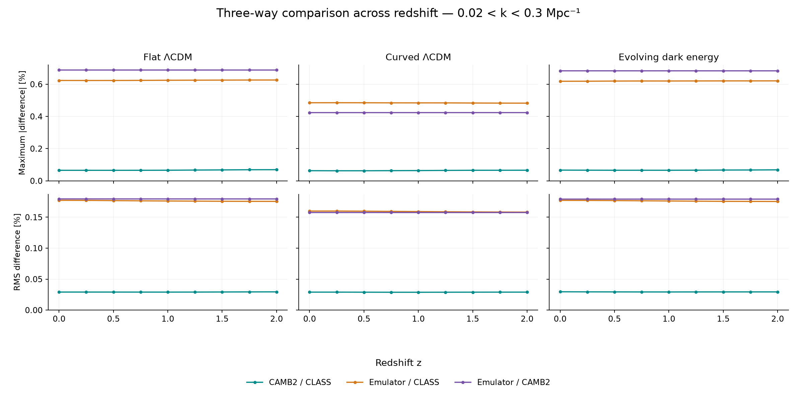

# Linear matter power: solvers and the current CBL emulator

## Latest comparison — 7 November 2026

The earlier solver comparison has now been extended to CosmoBolognaLib's existing
emulator. CAMB2, CLASS and Emmanuel’s existing emulator were compared at the
same cosmologies and redshifts using the supplied network weights.

All **three cosmologies at nine redshifts** have been evaluated: flat
LambdaCDM, curved LambdaCDM and evolving dark energy, at z=0, 0.25, 0.5,
0.75, 1, 1.25, 1.5, 1.75 and 2. Each case now has a CAMB 2.0.4 spectrum,
a CLASS 3.1.0 spectrum and an emulator spectrum. The earlier comparison below includes CAMB 1.6.6.

### Main result

The curves lie almost on top of each other in the power-spectrum plots.
However, the percentage-difference plots reveal a clear distinction:
**CAMB2 and CLASS agree more closely with each other than either agrees
with the emulator**, as measured by maximum and RMS differences
in every tested case in the focus range, 0.02 < k < 0.3 Mpc^-1.

The table gives the largest sampled absolute percentage difference found
across the nine redshifts, separately for each pair and cosmology. The
three entries in a row do not necessarily occur at the same k or redshift.

| Cosmology | CAMB2 / CLASS | Emulator / CLASS | Emulator / CAMB2 |
|---|---:|---:|---:|
| Flat LambdaCDM | 0.06920% | 0.62622% | 0.68817% |
| Curved LambdaCDM | 0.06589% | 0.48513% | 0.42375% |
| Evolving dark energy | 0.06832% | 0.62089% | 0.68329% |

The 0.68817% value is the largest absolute emulator/CAMB2 difference at a
sampled point in the flat model. The root mean square (RMS) summarizes the
size of the differences over all sampled points at a given redshift. Across
the nine redshifts, the emulator/CAMB2 RMS is approximately 0.1795% for flat
LambdaCDM, 0.1576% for curved LambdaCDM and 0.1792% for evolving dark energy.

The [data appendix](Data%20appendix.md) gives the numbers for each pair and
redshift across all three sampling ranges.

The emulator/CAMB2 differences change very little with redshift in these
tests. **Interpretation:** this is consistent with a persistent shape
difference being carried through the growth rescaling, rather than a
difference that becomes much larger with redshift. It does not identify
the physical or numerical cause of this behaviour. The curved case also uses
a different sampling grid, so its smaller maximum cannot by itself establish
that the emulator works better in curved cosmologies.

### What the emulator calculation includes

The network predicts a reference spectrum at z=0 from two density inputs.
The surrounding CBL code then changes its amplitude and shape using the
primordial parameters, the growth-factor ratio and the curvature correction.
This two-part construction is described in Emmanuel's Section 4.2, especially
Equation (4.3), and illustrated in Figure 4.3. The comparison uses predictions
from **the complete implementation**.

The unchanged DIFA CBL checkout is pinned to commit
`ca04c5e15a71b62207bad8f3c00c2cd22745b569`. The trained bundle is `Pk_def`;
its files are identical on the checked master and original `CAMB_emulator`
branch. This identifies the shipped implementation, but does not establish
that this is exactly the checkpoint used for every thesis result.

The input densities are Omega_b=0.04936781 and Omega_CDM=0.26447041 at the
reference h=0.6736. These follow from the same physical densities used in
the solver comparison: omega_b=0.0224 and omega_CDM=0.120, with omega=Omega h².
They lie inside both the thesis and shipped density ranges. The wider ranges
listed in the shipped metadata were not treated as a newly validated domain.

The saved CAMB2 and CLASS spectra were reused unchanged. The emulator uses
the same target H0, matter densities, As, ns, pivot, curvature and dark-energy
parameters listed in the earlier setup below. Its target radiation background
was set to the audited CLASS photon-plus-massless-neutrino density,
Omega_r=9.218085625177e-5. The dark-energy density closes the expansion equation.
All outputs use physical k in Mpc^-1 and P in Mpc³, with zero massive neutrinos
and linear power. The supplied As normalization was retained; no sigma8
renormalization was applied.

There is an important limitation to this matching. The trained bundle lists
Neff=3.04 and Omega_r=9.26535e-5, whereas the solver comparison uses Neff=3.044
and the radiation density calculated from TCMB. The network has no radiation
input, so setting the target growth background does not retrain its reference
spectrum or remove this difference in assumptions. The exact training CAMB
version, precision settings and complete training records have not been
established. The CAMB version bundled in the checkout is not proof of the
version used to create the training data.

For that reason, the measured residuals combine possible training-target,
solver-version, network, interpolation and growth-mapping differences.
The comparison therefore leaves the individual contribution of each source
undetermined. The thesis validation used its own settings. CLASS serves as
an independent comparison.

### How the differences were measured

For every pair A/B, the plotted residual is **100 × (P_A/P_B − 1)**.
For example, emulator/CLASS uses CLASS in the denominator. Positive values
mean that the first prediction is higher; negative values mean it is lower.

Each spectrum was compared on the existing CLASS k nodes, without an extra
CLASS interpolation. The emulator's own CBL interface interpolates its 400
native predictions using a cubic spline in linear k and linear P. That step
is part of the unchanged emulator implementation. The earlier CAMB2
interpolation is also retained, as described below.

The native emulator range starts at k=1.5e-4 Mpc^-1. The first two points of
the previous grid fall below it and were omitted from this new comparison,
not extrapolated. This leaves 99 common points per case; the sampled upper
endpoint is below 1 Mpc^-1. The focus range retains all its earlier points:
63 for flat and evolving dark energy, and 62 for curved LambdaCDM.

The statistics give equal weight to each retained k node. They are not
weighted by measurement uncertainties, bin widths or survey information.
The maximum is the largest value **on the sampled nodes**, not a proven
maximum between them. RMS is the square root of the mean squared residual;
the signed mean shows its average offset; the 95th percentile describes the
absolute residual below which 95% of the sampled values fall. A small signed
mean can hide positive and negative differences that cancel.

Three ranges are recorded: the complete common grid; the grid after applying
the low-k cuts used in Emmanuel's inference examples; and the earlier focus
interval. The thesis cuts are 8e-4 Mpc^-1 for curved LambdaCDM and 3e-3 Mpc^-1
for evolving dark energy (Chapter 5, Sections 5.2.1 and 5.2.2). For flat LambdaCDM,
the native lower limit is retained. These are conservative selections from
those examples, **not universal boundaries guaranteeing accuracy** for every
cosmology or redshift. Red shading on the power plots marks points below
the cuts; those points remain in the full-common-grid statistics.

### Power spectra and percentage differences

Each figure has one panel per redshift. Start with the power plot to see the
overall spectrum, then use its difference plot to see what the overlap hides.

| Cosmology | P(k) overlays | All three pairwise differences in the focus range |
|---|---|---|
| Flat LambdaCDM | [Power spectra](figures/05_three_way_power_flat.png) | [Percentage differences](figures/08_three_way_residuals_flat.png) |
| Curved LambdaCDM | [Power spectra](figures/06_three_way_power_curved.png) | [Percentage differences](figures/09_three_way_residuals_curved.png) |
| Evolving dark energy | [Power spectra](figures/07_three_way_power_evolving_de.png) | [Percentage differences](figures/10_three_way_residuals_evolving_de.png) |

### Checks, inference decision and next question

The compiled network suite passed all 10 test cases and 9,960 assertions.
The supplied growth suite passed 14 cases (543 assertions), and the
rescaling/normalization suite passed 15 cases (220 assertions). A separate
Python evaluation reproduced the compiled network to 8.9e-16 in log10(P)
and its interpolated spectrum to 1.2e-15 in relative power. All 243
pair-by-range statistical summaries were independently recomputed.
All 27 emulator predictions were repeated three times and returned identical
values. At the native grid points, the complete CBL path agrees with an
explicit reconstruction of its rescaling and unit conversion. At matching
flat z=0 reference settings, that reconstruction returns the raw network
spectrum. These checks help exclude basic interface and normalization errors. Physical accuracy would require a separate check.

The fixed-spectrum differences were calculated directly. A Markov chain
Monte Carlo (MCMC) study of effects on inferred parameters would require a
separate setup with observations or mock data, their uncertainties and
covariance, a likelihood, free parameters, priors and convergence checks.

The numerical comparison is complete, but the origin of the larger emulator
residual is unresolved. The next scientific question is to separate the
reference-spectrum mismatch from the growth mapping, starting with the flat
z=0 case and the original training provenance. CAMB2 retraining, timing claims
and massive neutrinos remain outside this experiment.

The [weekly update](../../../meetings/2026-11-11.md) summarizes the findings
for discussion with Professor Marulli.

## Earlier solver-only comparison — retained results

Before moving on to the emulator, the agreement between CAMB 1.6.6 and
CAMB 2.0.4 was examined using the same cosmological inputs. Following Professor
Marulli's suggestion, CLASS 3.1.0 was also included as an independent reference.
The comparison was first carried out for three models at z=0, then extended
to nine redshifts between z=0 and z=2.

**CAMB2 had smaller maximum and RMS differences from CLASS in all 27 tested
model–redshift combinations**, within 0.02 < k < 0.3 Mpc^-1. This shows closer
agreement with CLASS under the tested settings, but does not establish which
solver is closest to an exact solution.

## Comparison setup

The comparison uses the linear matter power spectrum, P(k), which describes
the strength of matter-density fluctuations at different spatial scales.
Linear theory treats those fluctuations as small. The calculations use this
approximation throughout, including on scales where real clustering would
require nonlinear physics.

Three models based on Emmanuel's Figure 4.3 were used: flat LambdaCDM, curved
LambdaCDM (kLambdaCDM), and evolving dark energy (w0waCDM). His figure compares
the emulator with CAMB, while this work compares the solvers themselves.

The settings were taken from the thesis wherever they were documented. Where
exact inputs were missing, the adopted choices were recorded in the
[source audit](../../02_shared_inputs_and_z0_reference/Source%20audit.md).
The comparison follows his examples, but is not an exact reproduction.

The original z=0 results were kept and checked against a backup. Adding eight
redshifts for each model required **216 new solver runs**, with three repeats
per solver and case, in addition to the 27 runs already completed at z=0.
Together, these give **27 model–redshift combinations** (3 models × 9 redshifts)
and **81 power-spectrum predictions** (3 models × 9 redshifts × 3 solvers).

## Inputs and method

### Common inputs

To make the comparison useful, each solver needs to calculate the same
physical quantity for the same cosmology. The matter densities, present
expansion rate and primordial fluctuation settings were kept fixed across
the three models. Within each model, all three solvers were given the same
stated physical inputs.

The comparison covers **z=0, 0.25, 0.5, 0.75, 1, 1.25, 1.5, 1.75 and 2**.
These redshifts, listed in Emmanuel's Chapter 5, Tables 5.1–5.3, were combined
with the three models in Figure 4.3 for this test.

All cases have zero massive neutrinos, but massless neutrinos still contribute
to the radiation density. The common inputs are:

- **H0=67.36 km/s/Mpc:** the present expansion rate.
- **omega_b=0.0224 and omega_cdm=0.120:** the physical baryon and cold-dark-matter
  densities, where omega=Omega × h² and h=H0/100.
- **As=2.1e-9 and ns=0.9649:** the primordial fluctuation amplitude and spectral tilt.
- **tau=0.0544:** the optical depth associated with reionization.
- **TCMB=2.7255 K, Neff=3.044 and YHe=0.245:** the CMB temperature, effective
  number describing neutrino radiation, and helium mass fraction.
- **pivot=0.05 Mpc^-1:** the reference scale for the primordial amplitude and tilt.

### Changes between the models

The curved model changes Omega_k, the spatial curvature parameter. The
evolving-dark-energy model changes w0 and wa, which describe the relation
between dark energy's pressure and density and how it changes with time.

| Model | Omega_k | w0 | wa |
|---|---:|---:|---:|
| Flat LambdaCDM | 0 | -1 | 0 |
| Curved LambdaCDM | 0.01 | -1 | 0 |
| Evolving dark energy | 0 | -0.99 | -0.02 |

For evolving dark energy, the form `w(a) = w0 + wa(1-a)` was used, where a
is the scale factor and equals 1 today. With w0=-0.99 and wa=-0.02, w crosses
-1 at a=0.5, or z=1.

Specifying w(a) determines the background behaviour of dark energy, but a
treatment of its perturbations must also be chosen. The usual simple-fluid
perturbation equations can become singular at w=-1 because they contain
terms involving division by 1+w. PPF, or parameterized post-Friedmann, was
used in both CAMB and CLASS to evolve the perturbations smoothly through
this crossing.

The settings were:

- **PPF / use_ppf=yes:** the perturbation treatment that handles the crossing.
- **cs2=1:** the squared dark-energy sound speed was set to unity in units
  where the speed of light is one. This concerns the perturbation response
  and does not mean w=1.
- **c_gamma/c_s=0.4:** the standard parameter controlling the transition
  between large- and small-scale behaviour in the PPF description was kept
  fixed, rather than fitted.
- **CLP:** the CLASS name for the same w(a) formula usually called CPL.

CLASS allows a cosmological constant, an evolving dark-energy component,
or both. For this experiment, a single evolving component was used.
Omega_Lambda was therefore set to zero, and the required dark-energy density
was supplied by the evolving component.

The present dark-energy density is calculated from the expansion equation.
When curvature changes while H0 and the matter densities stay fixed, the
dark-energy density adjusts accordingly.

### Matching the outputs

The units and matter-density definitions were matched before comparing the
spectra. The same synchronous-gauge baryon-plus-cold-dark-matter spectrum was
used in all three solvers, without rescaling to a chosen sigma8 amplitude.
Here the gauge is the coordinate convention used to describe the fluctuations.

CLASS was called through CosmoBolognaLib's Table_PkCodes interface, which
returns its original output table. CLASS's native k points were kept, and
CAMB predictions were requested at those points. This avoids the extra
interpolation in CBL's higher-level Pk_matter method. CAMB still uses its
own interpolation to return values at the requested points.

### Scales and solver settings

The wavenumber k labels spatial scale: larger k corresponds to smaller scales.
The saved comparison covers **1e-4 <= k <= 1 Mpc^-1**, with both solvers asked
to calculate through k=2 Mpc^-1.

The main figure uses **0.02 < k < 0.3 Mpc^-1**, which includes scales with
wiggles from baryon acoustic oscillations (BAO). This interval is useful for
examining agreement because two spectra can look almost identical overall
while differing around those features. Each solver retained its native
numerical settings and recombination treatment, so the comparison includes
those differences as well as numerical effects.

## Results

At each sampled scale, the percentage difference was calculated as:

**Difference (%) = 100 × (P_CAMB / P_CLASS − 1).**

Positive values mean CAMB predicts more power than CLASS; negative values
mean less. The differences were summarized using the largest absolute value
and RMS, or root mean square. RMS squares the differences before averaging
and taking the square root, so positive and negative values do not cancel.

### Agreement across redshifts

Each column represents a cosmology. The top row shows the largest sampled
difference in the chosen k interval, and the bottom row shows RMS.
Each point is one calculated redshift; the connecting lines are just guides to the eye.

**CAMB2 stays closer to CLASS by both measures at every redshift tested.**
The differences change relatively little between z=0 and z=2, so the pattern
seen at z=0 also holds at the earlier times sampled here.

These are the largest differences in 0.02 < k < 0.3 Mpc^-1 across all nine
redshifts. All six occur at z=2.

| Model | CAMB 1.6.6 maximum | z at maximum | CAMB 2.0.4 maximum | z at maximum |
|---|---:|---:|---:|---:|
| Flat LambdaCDM | 0.140297% | 2 | 0.069197% | 2 |
| Curved LambdaCDM | 0.159183% | 2 | 0.065888% | 2 |
| Evolving dark energy | 0.140659% | 2 | 0.068325% | 2 |

### The power spectra

The next plots show P(k) itself, with one panel per redshift. Grey solid is
CLASS, orange dashed is CAMB 1.6.6, and teal dotted is CAMB 2.0.4. All panels
use the same axis ranges. The horizontal axis is k in Mpc^-1 and the vertical
axis is P(k, z) in Mpc³; both are logarithmic. The grey band marks the k
interval used in the main comparison.

The three curves nearly overlap because their differences are small compared
with the range of P(k) shown. The disagreement figure above is better suited
to seeing those small differences. Lines only join the saved points, and no extra k
values were calculated for these plots.

Within each model, the power is generally lower at higher redshift. This is
consistent with matter fluctuations having had less time to grow, so it describes
the evolution of the spectrum, rather than a change in solver error.

#### Flat LambdaCDM

#### Curved LambdaCDM

#### Evolving dark energy

The [data appendix](Data%20appendix.md#earlier-solver-comparison) gives the
solver differences at each redshift and the maxima over the full sampled range.

## Checks and remaining limits

The checks covered the inputs actually read by the solvers, units, matter
definitions, background densities, spectrum reconstruction, and saved file
fingerprints. All repeated spectra matched exactly, and all original z=0
arrays and statistics were recovered unchanged.

This shows that the calculation is repeatable. **A convergence test is still
needed:** repeating the same settings does not establish whether the result
stays stable when numerical precision is increased.

The maxima apply to the sampled k points; larger differences could lie
between them. Smaller maximum and RMS values also do not imply that CAMB2
is closer to CLASS at every individual k.

The Markov chain Monte Carlo (MCMC) run suggested by Professor Marulli has
not yet been performed, as its setup still needs to be defined. The accuracy-boost comparison within
CAMB 2.0.4 has also been set aside for now.

## Calculation records

The numerical data, unrounded statistics and detailed checks are kept in the
local research workspace, together with the raw runs, scripts and SVG figures.
The tables and PNG plots above are the results shared here for discussion.
