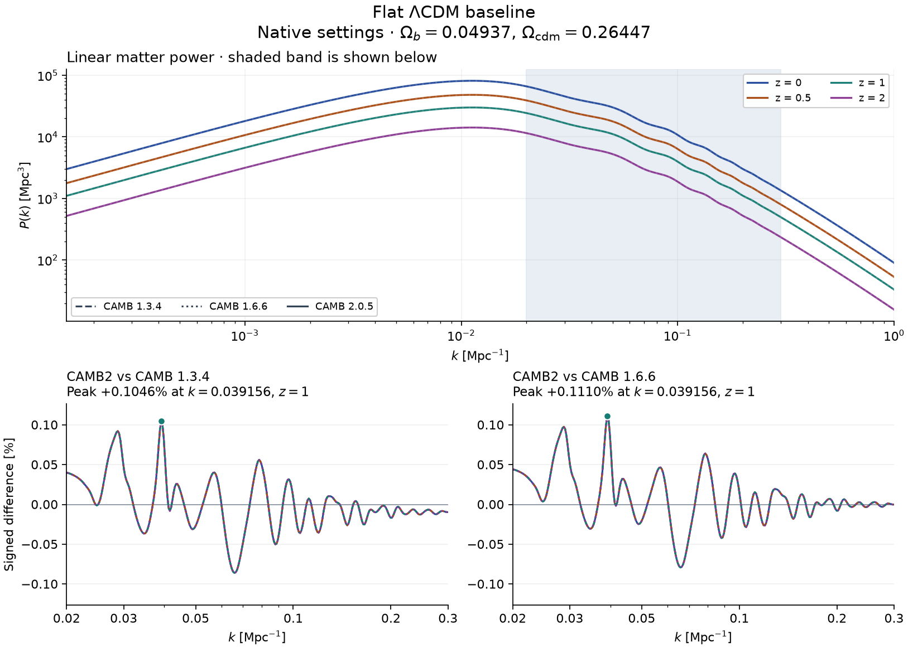
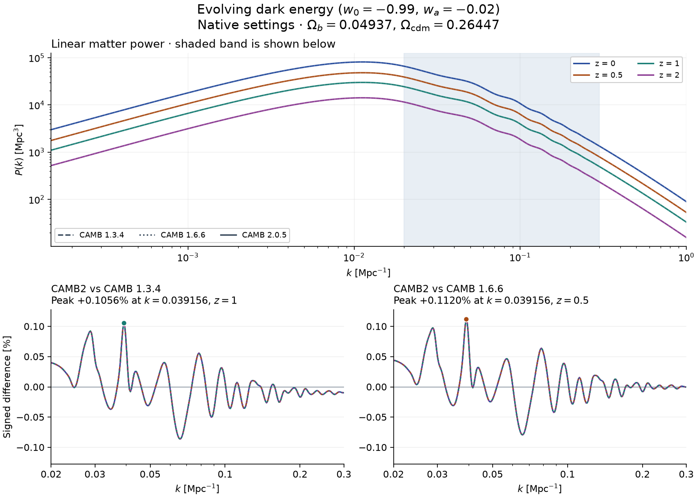

# Plot appendix — CAMB version comparison

Each of the 52 cases presented in the report has its own figure.  [three controls](#control-cosmologies) compare the models, and a [density grid](#density-grid) opens any of the 49 flat
$\Lambda\mathrm{CDM}$ cases. All figures use the saved native-settings
runs at `AccuracyBoost = 1` and show $z=0,\,0.5,\,1,\,2$.

[Short report](Short%20report.md) · [Detailed report](Report.md) · [Data appendix](Data%20appendix.md) · [Figure index](Figure%20index.md)

## How to read each figure

The upper panel shows $P(k)$ from all three CAMB versions across the
full saved $k$ range. The curves often sit on top of each other. The
two lower panels show the percentage differences over the shaded
interval, $0.02 < k < 0.3\,\mathrm{Mpc}^{-1}$. A positive difference
means CAMB2 predicts more power than the older version.

The dot marks the largest absolute gap across all four redshifts.
Its value, $k$, and $z$ are printed above the panel. The two lower
panels use the same vertical scale within each figure, but that scale
can change between cosmologies, and therefore one must compare the axis values, not just the height of the curves.

## Control cosmologies

### Flat baseline

### Curved cosmology

### Evolving dark energy

## Density grid

The rows give $\Omega_b$ and the columns give $\Omega_{\rm cdm}$.
Each link opens the figure for that pair. The case labels match the
[data appendix](Data%20appendix.md).

| $\Omega_b$ | 0.070 | 0.175 | 0.280 | 0.385 | 0.490 | 0.595 | 0.700 |
| ---: | --- | --- | --- | --- | --- | --- | --- |
| 0.030 | [b0c0](figures/plot-appendix/grid_b0c0.png) | [b0c1](figures/plot-appendix/grid_b0c1.png) | [b0c2](figures/plot-appendix/grid_b0c2.png) | [b0c3](figures/plot-appendix/grid_b0c3.png) | [b0c4](figures/plot-appendix/grid_b0c4.png) | [b0c5](figures/plot-appendix/grid_b0c5.png) | [b0c6](figures/plot-appendix/grid_b0c6.png) |
| 0.035 | [b1c0](figures/plot-appendix/grid_b1c0.png) | [b1c1](figures/plot-appendix/grid_b1c1.png) | [b1c2](figures/plot-appendix/grid_b1c2.png) | [b1c3](figures/plot-appendix/grid_b1c3.png) | [b1c4](figures/plot-appendix/grid_b1c4.png) | [b1c5](figures/plot-appendix/grid_b1c5.png) | [b1c6](figures/plot-appendix/grid_b1c6.png) |
| 0.040 | [b2c0](figures/plot-appendix/grid_b2c0.png) | [b2c1](figures/plot-appendix/grid_b2c1.png) | [b2c2](figures/plot-appendix/grid_b2c2.png) | [b2c3](figures/plot-appendix/grid_b2c3.png) | [b2c4](figures/plot-appendix/grid_b2c4.png) | [b2c5](figures/plot-appendix/grid_b2c5.png) | [b2c6](figures/plot-appendix/grid_b2c6.png) |
| 0.045 | [b3c0](figures/plot-appendix/grid_b3c0.png) | [b3c1](figures/plot-appendix/grid_b3c1.png) | [b3c2](figures/plot-appendix/grid_b3c2.png) | [b3c3](figures/plot-appendix/grid_b3c3.png) | [b3c4](figures/plot-appendix/grid_b3c4.png) | [b3c5](figures/plot-appendix/grid_b3c5.png) | [b3c6](figures/plot-appendix/grid_b3c6.png) |
| 0.050 | [b4c0](figures/plot-appendix/grid_b4c0.png) | [b4c1](figures/plot-appendix/grid_b4c1.png) | [b4c2](figures/plot-appendix/grid_b4c2.png) | [b4c3](figures/plot-appendix/grid_b4c3.png) | [b4c4](figures/plot-appendix/grid_b4c4.png) | [b4c5](figures/plot-appendix/grid_b4c5.png) | [b4c6](figures/plot-appendix/grid_b4c6.png) |
| 0.055 | [b5c0](figures/plot-appendix/grid_b5c0.png) | [b5c1](figures/plot-appendix/grid_b5c1.png) | [b5c2](figures/plot-appendix/grid_b5c2.png) | [b5c3](figures/plot-appendix/grid_b5c3.png) | [b5c4](figures/plot-appendix/grid_b5c4.png) | [b5c5](figures/plot-appendix/grid_b5c5.png) | [b5c6](figures/plot-appendix/grid_b5c6.png) |
| 0.060 | [b6c0](figures/plot-appendix/grid_b6c0.png) | [b6c1](figures/plot-appendix/grid_b6c1.png) | [b6c2](figures/plot-appendix/grid_b6c2.png) | [b6c3](figures/plot-appendix/grid_b6c3.png) | [b6c4](figures/plot-appendix/grid_b6c4.png) | [b6c5](figures/plot-appendix/grid_b6c5.png) | [b6c6](figures/plot-appendix/grid_b6c6.png) |
