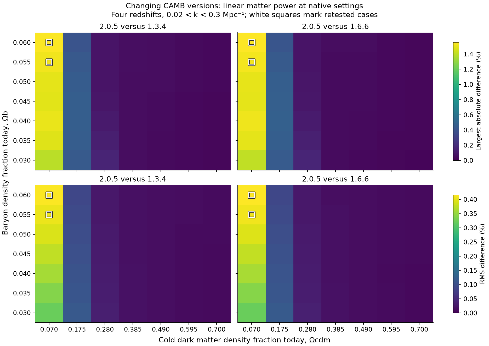

# Is CAMB2 upgrade worth it?

In this report, I answer two questions: 
If CAMB2 were used to generate the training spectra for the (CBL) emulator,
1. how much time would it save?
2. How much would the spectra change?
This report compares CAMB 1.3.4 from the CBL source, CAMB 1.6.6, and CAMB 2.0.5. This comparison only tests the solvers themselves.

For this purpose, I created a $7\times7$ density grid: 49 cosmologies
formed by pairing seven values of $\Omega_b$ (the baryon density fraction)
with seven values of $\Omega_{\rm cdm}$ (the cold dark matter density
fraction).
Each square in the [Figure index](Figure%20index.md) represents one of those cosmologies.

With each build at its usual settings, a typical CAMB2 run across the
density grid took **about a quarter as long** as either older build.
The largest gap in the power prediction was about **1.55%**, at the
corner with the lowest $\Omega_{\rm cdm}$ and the highest $\Omega_b$.
Matching the recombination calibration did not change that gap.

## What was compared

To see where the predictions differ most, the flat $\Lambda\mathrm{CDM}$
grid covered $0.03 \le \Omega_b \le 0.06$ and
$0.07 \le \Omega_{\rm cdm} \le 0.70$. These ranges come from Table 4.1
of Emmanuel’s thesis.

Together with the grid, the three controls bring the comparison shown here
to **52 cases**: 49 density pairs, the flat baseline, curved
$\Lambda\mathrm{CDM}$, and a model with evolving dark energy.

All three versions calculated linear matter power, $P(k)$, at
$z=0,\,0.5,\,1,\,2$. The spectra were compared at the same wavenumbers
$k$, which label different physical scales. The results here refer to
**$0.02 < k < 0.3\,\mathrm{Mpc}^{-1}$**; the [data appendix](Data%20appendix.md) also
covers the wider saved interval.

## What changes with each version's usual settings?

Each version received the same cosmological
inputs but kept its usual numerical settings, including
`AccuracyBoost = 1`, and its own calibration for recombination. A gap
shows what changes when switching versions, not which prediction is more
accurate.

Each square in the figure represents one pair of densities. The top panels
show the largest difference across all sampled scales and redshifts.
In both comparisons, **17 of 49** squares had at least one difference
above 0.1%. The largest gaps, **1.54% against 1.3.4** and **1.56%
against 1.6.6**, both came from the corner with the lowest
$\Omega_{\rm cdm}$ and highest $\Omega_b$. These are peaks, not shifts
of that size across the whole spectrum. For example, the largest
difference in one square may occur at a different $k$ or $z$ than the
largest difference in another square.

**Where do the gaps above 1% occur?** Seven squares exceeded 1% in
the comparison range, all at $\Omega_{\rm cdm}=0.070$. The
[plots against CAMB 1.3.4](figures/05_gaps_above_1pct_vs_camb_1_3_4.png)
and [against CAMB 1.6.6](figures/06_gaps_above_1pct_vs_camb_1_6_6.png)
show the percentage difference as a function of $k$ at all four
redshifts. Each panel marks the largest absolute gap and labels its
$k$ and $z$. The peaks cluster near $k=0.0303$–$0.0328\,\mathrm{Mpc}^{-1}$.
The four curves nearly overlap, even where a different redshift gives
the largest difference.

CAMB2 was faster at every point on the density grid. The median speedup
was **3.76×** over 1.3.4 and **3.83×** over 1.6.6. For the flat $\Lambda\mathrm{CDM}$ baseline,
all four spectra took **0.141 s** with CAMB2, compared with **0.537 s**
with 1.3.4 and **0.543 s** with 1.6.6. Each time is the median of three
single-threaded runs and excludes overhead times spent on tasks such as startup, saving files, and running CBL. 
We can't tell how much of that speedup comes from the solver code versus how much is due to the compilation.
[Runtime across the density grid](figures/02_native_runtime_maps.png)

## Does the change in recombination explain the gap?

The [CAMB2 paper, Section V.B](https://arxiv.org/pdf/2607.14854#page=8),
explains that CAMB2 kept the same basic recombination model but tuned
it to match a more detailed calculation called CosmoRec. To check
whether that update explained the gap, CAMB2 was run with the older
calibration at the two grid points with the largest gaps and at all
three controls shown here, using
`p.Recomb.set_params(recfast_approx_model="planck")`.
Here, `p` is the CAMB parameter object, and `"planck"` selects the older
Planck-era calibration of RECFAST, which both CAMB 1 versions use.
It changes the coefficients in the recombination calculation and
switches off CAMB2's new helium-rate correction. The numerical settings
were kept fixed for this comparison. The largest gap at the corner
with the lowest $\Omega_{\rm cdm}$ and highest $\Omega_b$ stayed near
**1.55%**, so the calibration change did not explain it. Changing
numerical settings might reduce the gap, but `AccuracyBoost = 1`
remains the working setting for this project as discussed in the clustering group's meeting.

## What CAMB2 adds to CBL and to the emulator

### 1. Upgrading the solver that CBL calls directly

CBL already uses CAMB outside the emulator. In the checkout inspected
for this benchmark, the `CAMB` option runs the bundled executable and
reads back its spectrum. The separate `CAMB_wrapper` option calls the
compiled Fortran routines from inside CBL, reaching `CAMB_GetResults`
in `Wrappers/CAMBwrapper/CAMBinterface.f90`. These are both full
solver calculations, not neural-network predictions. The CBL example
`Examples/cosmology/Pk_BoltzmannSolver.cpp` uses the first option to
compare CAMB with CLASS. CBL can also use CAMB spectra to calculate
the matter correlation function used in clustering models.

| What changes in CAMB2? | Why it matters for direct use in CBL |
|---|---|
| **Faster linear spectrum calculation in this benchmark.** At `AccuracyBoost = 1`, the CAMB2 build was about **3.8× faster** than either older build for the typical grid case. | A faster solver can save time when new spectra have to be calculated repeatedly. The benchmark called CAMB through Python, so this is not a measured speedup for either CBL interface or for an entire clustering fit. |
| **Updated recombination and evolving dark energy.** The default recombination model was recalibrated, and CAMB2 changed how it solves the equations for dark-energy fluctuations to improve numerical stability. [Paper, Section V.B](https://arxiv.org/pdf/2607.14854#page=8) and [Section VII](https://arxiv.org/html/2607.14854#S7) | Direct solver calculations can use these updated treatments after the interface has been checked. Matching the old recombination calibration did not explain the 1.55% gap in this benchmark. |
| **Updated massive-neutrino calculation.** CAMB already supported massive neutrinos; CAMB2 changes how it calculates their energy density and the evolution of their fluctuations. [Paper, Section VI](https://arxiv.org/html/2607.14854#S6) | This is relevant to direct calculations for clustering models with massive neutrinos. The benchmark used no massive neutrinos, so it does not measure the benefit for those models. |
| **SP(k), a new nonlinear option.** It models how gas redistribution from galaxy feedback changes matter power on small scales. [Paper, Section VIII](https://arxiv.org/html/2607.14854#S8) | This adds a modelling choice if a CBL analysis needs nonlinear spectra and the interface exposes that option. It was not used in this linear benchmark. |
| **A built-in numerical check.** The Python tool `check_accuracy` reports how much a result moves when the solver settings are tightened. [Paper, Section IX](https://arxiv.org/html/2607.14854#S9) | It can be used to check standalone reference spectra when needed. It does not require changing the project's working setting of `AccuracyBoost = 1`. |

The paper also reports large speed gains for **lensed CMB spectra in
curved models** and describes an optional small-scale **reionization
heating test**. Neither was part of the timing comparison for clustering.
[Paper, Section XI and Appendix B](https://arxiv.org/html/2607.14854)

### 2. Retraining the current CBL emulator on CAMB2

The reason to retrain the emulator is to give CBL a starting spectrum
that follows CAMB2. Replacing the bundled solver updates CBL’s direct
CAMB calculations, but the emulator will only learn CAMB2’s predictions after it is trained on new CAMB2 spectra.

To retrain the emulator, CAMB2 would first calculate reference spectra
at $z=0$ for many pairs of $\Omega_b$ and $\Omega_{\rm cdm}$.
Those spectra would then serve as examples for training `Pk_def`:
the network's weights would be adjusted so that its predictions
match the CAMB2 examples. The solver version and settings would be
recorded so those examples could be reproduced. Faster solver calls
could save time when generating the examples, not when evaluating
the trained network.

The [previous comparison](../01_current_solver_comparison/results/Report.md)
showed that the current emulator already agrees fairly closely with
standalone CAMB2. The largest gap in each of the three tested cosmologies
was between **0.42% and 0.69%**. This tells us how the current emulator
performs, not how much closer to CAMB2 it could get after retraining.

To find out, the current and retrained emulators should be compared
against the same CAMB2 spectra, using cases left out of the new training
set. The first check is the starting spectrum at $z=0$, before CBL
adjusts it. If the gap is already there, retraining could help. If the
starting spectrum agrees well but the gap appears after CBL adjusts it
for a different cosmology or redshift, retraining the network alone is
unlikely to fix it. Training on linear spectra without massive neutrinos
would not extend the emulator to nonlinear power or massive neutrinos.

[Short report](Short%20report.md) · [Plot appendix](Plot%20appendix.md) · [Data appendix](Data%20appendix.md) · [Figure index](Figure%20index.md)

AI USAGE DISCLAIMER
AI tools helped draft and edit this report, plot and organize the figures, and prepare the data appendix and plot appendix from the saved numerical results. I reviewed and revised the report before approving it for publication on GitHub.
