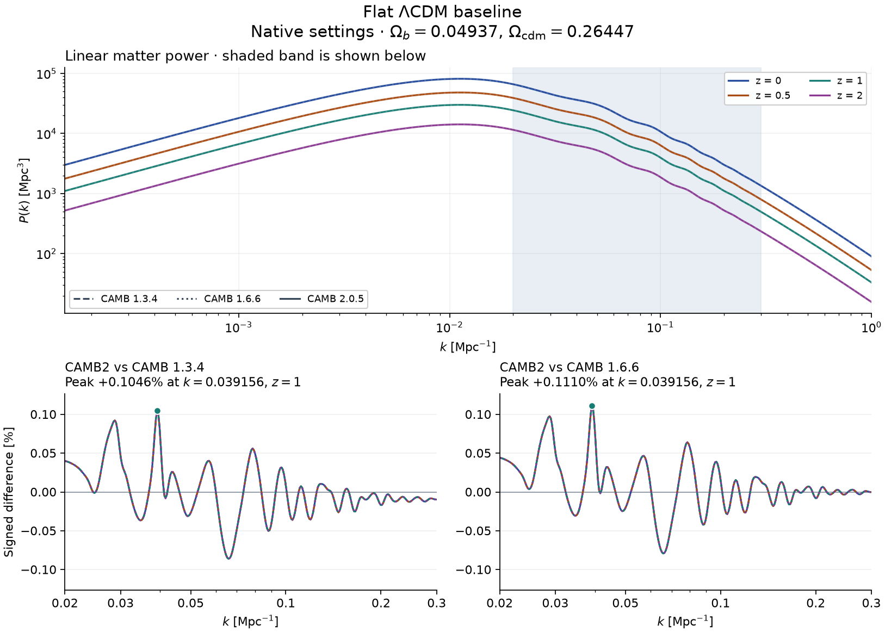
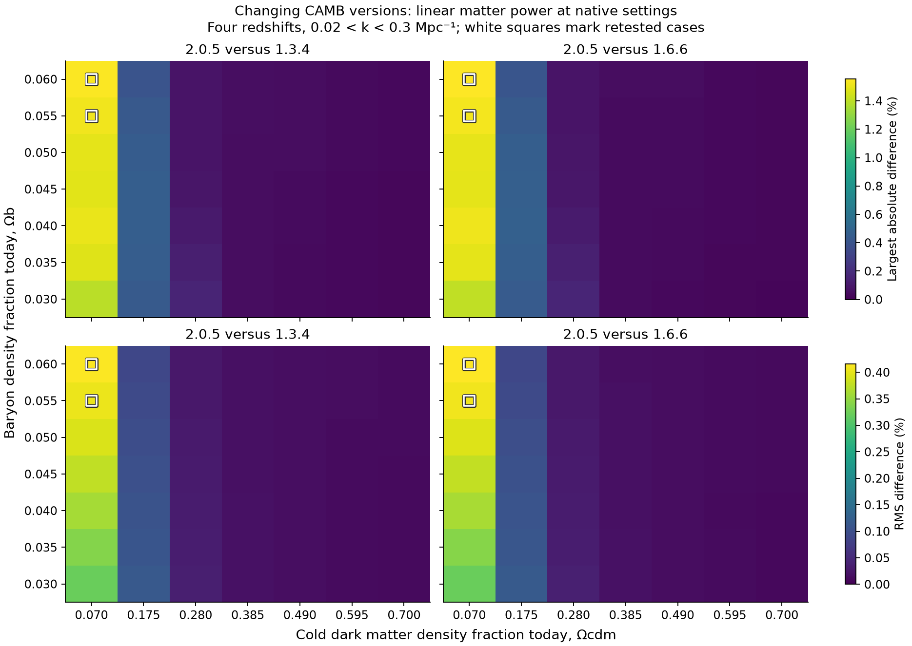
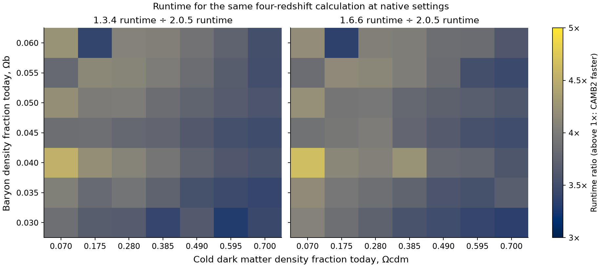

# Is CAMB2 worth using for clustering?

I compared the CAMB 1.3.4 source bundled with CosmoBolognaLib, CAMB 1.6.6,
and CAMB 2.0.5. The goal was to find out whether switching to CAMB2 changes
the linear matter power spectrum used by the **current CBL emulator**, and
whether it saves time for the same calculation. This is a solver test:
the emulator itself was not retrained or changed.

The comparison shows 49 combinations of $\Omega_b$ and $\Omega_{\rm cdm}$,
plus three controls: the flat baseline, curved $\Lambda\mathrm{CDM}$,
and evolving dark energy. Each run returned power spectra at
redshifts 0, 0.5, 1 and 2, on the same grid of scales for all versions.
The numbers below focus on 0.02 < k < 0.3 Mpc⁻¹. All three versions
calculated linear power, with no massive neutrino species.

## What changes when you upgrade?

With each version at its usual settings, including `AccuracyBoost = 1`,
CAMB2 was about **3.8 times faster** on the median density-grid case,
relative to either older version.
For the flat LambdaCDM cosmology, the run took **0.141 seconds** with
CAMB2, compared with **0.537 seconds** for 1.3.4 and **0.543 seconds**
for 1.6.6. These are timings for one calculation returning all four
redshifts. They do not include running the CBL wrapper or fitting a
galaxy-clustering model.

For most of the grid, the largest change in power stayed below 0.1%.
The largest differences were **1.54% against 1.3.4** and **1.56% against
1.6.6**, both at the grid corner with the least cold dark matter and
the most baryons. The heatmap shows that the largest values are concentrated at
the lowest cold-dark-matter density. A gap at native settings includes
differences in the solvers’ numerical settings and their default
recombination calibration. It is not a direct accuracy measurement.

## Did the change in recombination explain the gap?

CAMB2 updated the way its recombination model is tuned. I checked
whether that update explained the difference by using the same
calibration as the older CAMB versions, with the numerical settings
held fixed. The largest gap stayed near **1.55%**. Changing numerical
settings might reduce it, but `AccuracyBoost = 1` remains the working
setting for this project.

## What would upgrading change in CBL?

**For direct solver calls**, CBL can run CAMB without using the emulator.
That is where the faster spectrum calculation could save time, once it
has been tested through the CBL interface. The new solver also updates
its treatment of recombination, evolving dark energy and massive
neutrinos, and adds SP(k) as an option for nonlinear matter power.
Those updates and their limits are explained in the [detailed report](Report.md#what-camb2-adds-to-cbl-and-to-the-emulator).

**For emulator predictions**,
1. **It’s 3.8× faster for the calculation we need,** which makes it attractive for generating training data. It doesn’t mean the trained network or the full CBL workflow gets 3.8× faster.
2. **It agrees better with an independent solver.** In the earlier CAMB 1.6.6 vs CAMB 2.0.4 comparison, CAMB2 was closer to CLASS, even though CLASS isn’t the exact truth.

The missing result is whether the current emulator can benefit from the change. Retraining is needed for the emulator to learn the new reference spectra to test whether upgrading to CAMB2 will actually improve the emulator's predictions.

[Detailed report](Report.md) · [Plot appendix](Plot%20appendix.md) · [Data appendix](Data%20appendix.md) · [Figure index](Figure%20index.md)
