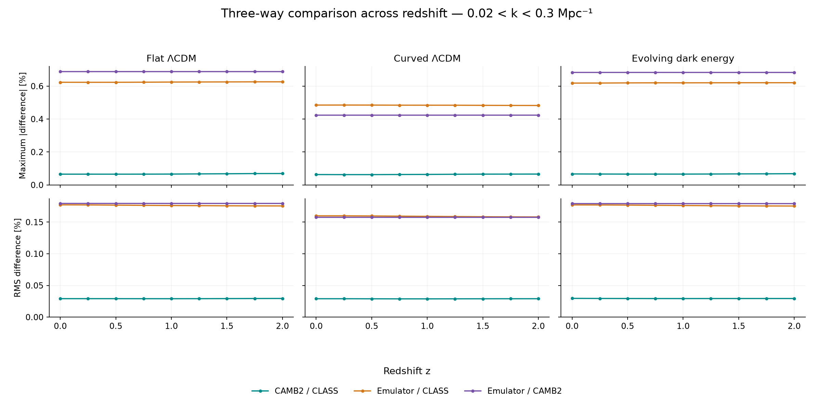
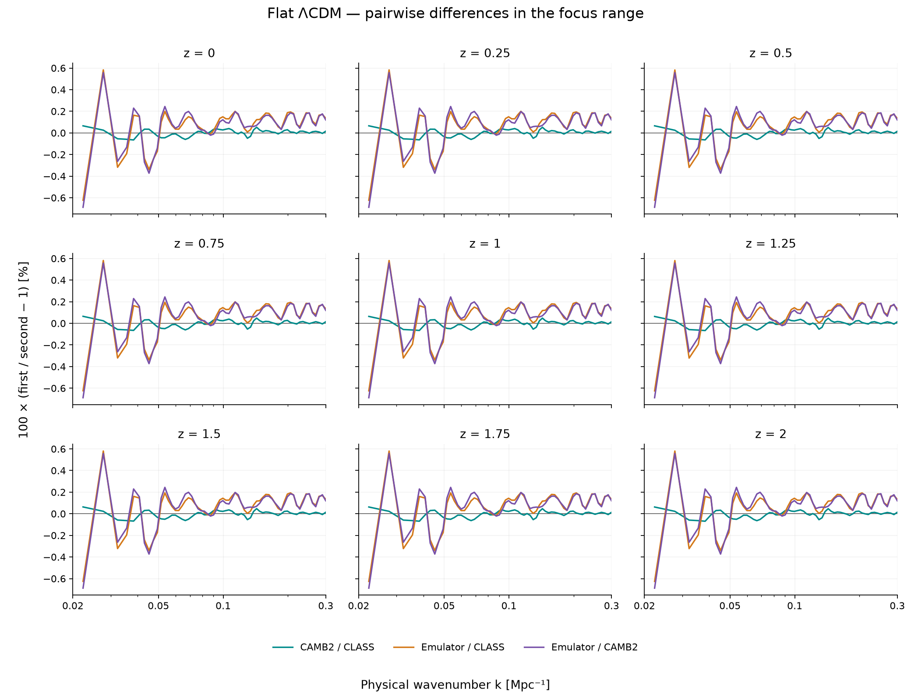

# Weekly update — 11 November 2026

I tested Emmanuel’s existing emulator in CosmoBolognaLib alongside CAMB2
and CLASS for **three cosmologies at nine redshifts**. I used the saved
CAMB2 and CLASS predictions from the earlier comparison so that the new
emulator spectra could be compared on the same footing.

## What the plots show

In the range 0.02 < k < 0.3 Mpc⁻¹, the largest sampled differences between
**CAMB2 and CLASS stayed below 0.07%**. The largest differences between
**the emulator and CAMB2 were 0.69% for flat ΛCDM, 0.42% for curved ΛCDM,
and 0.68% for evolving dark energy**. The upper panels show the largest
differences at each redshift. The lower panels show the root mean square,
which summarizes the size of the differences across the sampled scales.

The flat model illustrates where the predictions differ. The largest
emulator/CAMB2 difference occurs near k = 0.0223 Mpc⁻¹. The pattern of
differences across scale looks very similar at all nine redshifts.

## What I want to check next

The cause of the larger emulator differences is still open. The original
training settings are only partly known, and the radiation assumptions in
the trained emulator differ from those in the solver runs. The result
compares complete predictions, including how the emulator rescales its
reference spectrum to other redshifts.

I’d like to start with flat ΛCDM at z=0 and compare the emulator’s reference
spectrum with a solver run using the original training settings, if those
settings can be recovered. That would help establish how much of the
difference is already present at the reference redshift.

[Detailed report](../camb-comparison/01_current_solver_comparison/results/Report.md) ·
[Data appendix](../camb-comparison/01_current_solver_comparison/results/Data%20appendix.md) ·
[All figures](../camb-comparison/01_current_solver_comparison/results/figures/Figure%20index.md)
